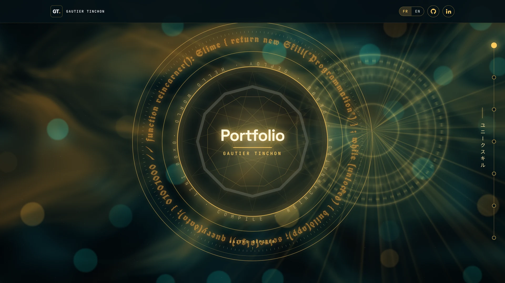
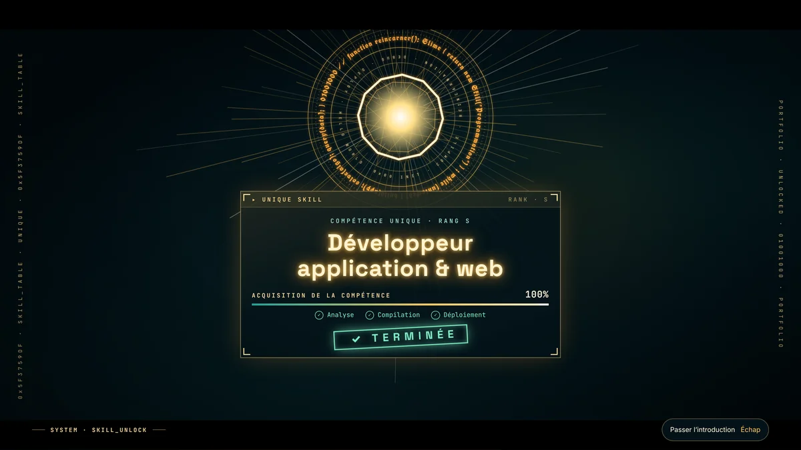
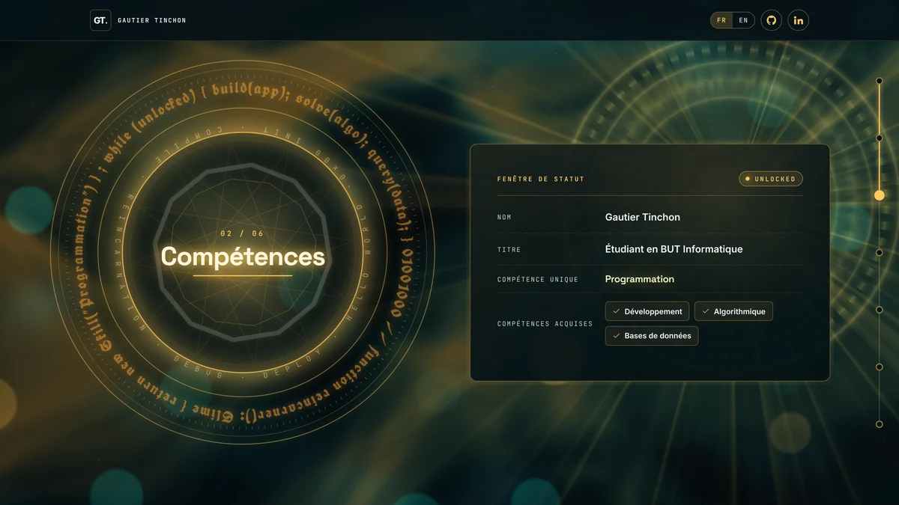
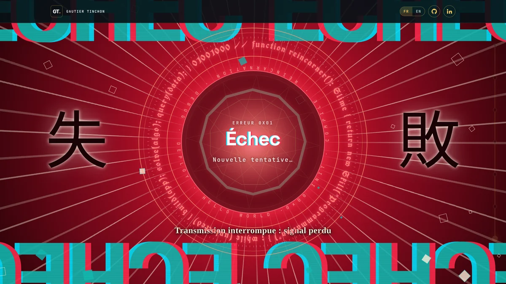

<b>🇫🇷 Version française</b>

# Salut, moi c’est Gautier 👋

**Étudiant en 2e année de BUT Informatique · IUT de Lens**
**Développeur application & web**

> 🔎 **Je recherche un stage de développement informatique** de 8 à 10 semaines, **à partir du 12 avril 2027**, à Lens, Liévin ou dans les environs.
> N’hésitez pas à me contacter !

---

## À propos

Étudiant en 2e année de BUT Informatique, je suis sérieux, motivé et désireux d’apprendre. J’aime mettre en pratique mes compétences en **développement web et logiciel** (PHP/Laravel, Java, C#, Python) et découvrir de nouvelles technologies.

- 💻 Développement d’**applications et de sites web**
- 🎮 Création de **jeux vidéo** sur mon temps libre (Godot, Unity)
- 🧩 **Algorithmique** et gestion de **données**

## Compétences

**Langages et frameworks**

**Outils**

## Projet à la une : mon portfolio

Un portfolio mis en scène comme une **réincarnation façon RPG** : le « système » détecte une compétence unique, l’acquiert, puis débloque le site. On le parcourt ensuite partie par partie, guidé par un cercle magique.

| Introduction | Compétences | Formulaire de contact |
|:---:|:---:|:---:|
|  |  |  |

- une introduction cinématique : fenêtres système, glitch, explosion de lumière et jauge d’acquisition ;
- un fond animé en **WebGL**, avec des shaders écrits à la main et une qualité qui s’adapte à la machine ;
- une navigation en chapitres, des cadres qui se forment à partir d’éclats de cristal puis se décodent ;
- un formulaire qui envoie vraiment les messages, avec une animation d’échecs puis de réussite ;
- une version bilingue FR / EN, responsive et accessible.

`React` `TypeScript` `Vite` `Tailwind CSS` `WebGL`

<!-- Quand le site est en ligne, décommente la ligne suivante et mets le bon lien :
[▶ **Voir le portfolio en ligne**](https://xxxxx.vercel.app)
-->

## Autres projets

| Projet | Type | Technologies |
|---|---|---|
| **Générateur de fractales** | Universitaire · groupe de 4 · 2e année | Java, IntelliJ, GitLab |
| **Site web « Projet Fil Rouge »** | Universitaire · groupe de 3 · 2e année | PHP, Laravel, HTML, CSS, Bootstrap, PhpStorm, GitLab |
| **Space Invaders en JavaFX** | Universitaire · groupe de 4 · 2e année | Java, JavaFX, IntelliJ, GitLab |
| **Page web d’un magasin de réparation électronique** | Universitaire · groupe de 3 · 1re année | HTML, CSS |
| **Tower defense 2D** | Personnel · en équipe | C#, Godot, GitHub |
| **Plateformer 2D** | Personnel · solo | C#, Unity |

<b>🇬🇧 English version</b>

# Hi, I’m Gautier 👋

**Second-year Computer Science student (BUT Informatique) · IUT de Lens, France**
**Application & web developer**

> 🔎 **I’m looking for a software development internship** of 8 to 10 weeks, **starting April 12, 2027**, in or around Lens / Liévin (France).
> Feel free to get in touch!

---

## About me

I’m a second-year Computer Science student: serious, motivated and eager to learn. I enjoy putting my **web and software development** skills into practice (PHP/Laravel, Java, C#, Python) and discovering new technologies.

- 💻 Building **applications and websites**
- 🎮 Making **video games** in my free time (Godot, Unity)
- 🧩 **Algorithms** and **data** management

## Skills

**Languages & frameworks**

**Tools**

## Featured project: my portfolio

A portfolio staged like an **RPG reincarnation**: the “system” detects a unique skill, acquires it, then unlocks the site. You then explore it section by section, guided by a magic circle.

| Intro | Skills | Contact form |
|:---:|:---:|:---:|
|  |  |  |

- a cinematic intro: system windows, glitch effects, a burst of light and a skill acquisition gauge;
- an animated **WebGL** background, with hand-written shaders and quality that adapts to the device;
- chapter-based navigation, with panels that assemble from crystal shards and then decode;
- a contact form that really sends messages, with an animation of failed attempts followed by success;
- bilingual FR / EN, responsive and accessible.

`React` `TypeScript` `Vite` `Tailwind CSS` `WebGL`

<!-- Once the site is online, uncomment the next line and add the right link:
[▶ **View the live portfolio**](https://xxxxx.vercel.app)
-->

## Other projects

| Project | Type | Technologies |
|---|---|---|
| **Fractal generator** | University · team of 4 · 2nd year | Java, IntelliJ, GitLab |
| **“Projet Fil Rouge” website** | University · team of 3 · 2nd year | PHP, Laravel, HTML, CSS, Bootstrap, PhpStorm, GitLab |
| **Space Invaders in JavaFX** | University · team of 4 · 2nd year | Java, JavaFX, IntelliJ, GitLab |
| **Web page for an electronics repair shop** | University · team of 3 · 1st year | HTML, CSS |
| **2D tower defense** | Personal · team | C#, Godot, GitHub |
| **2D platformer** | Personal · solo | C#, Unity |

